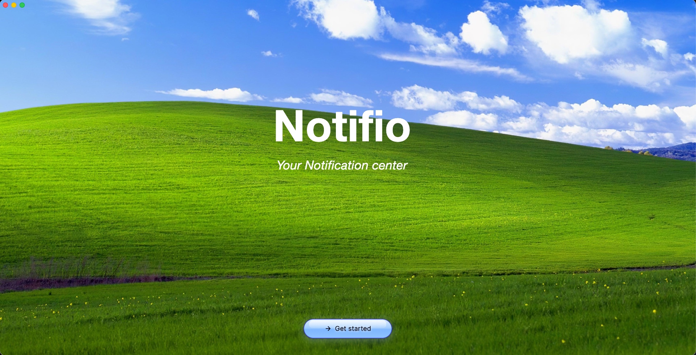
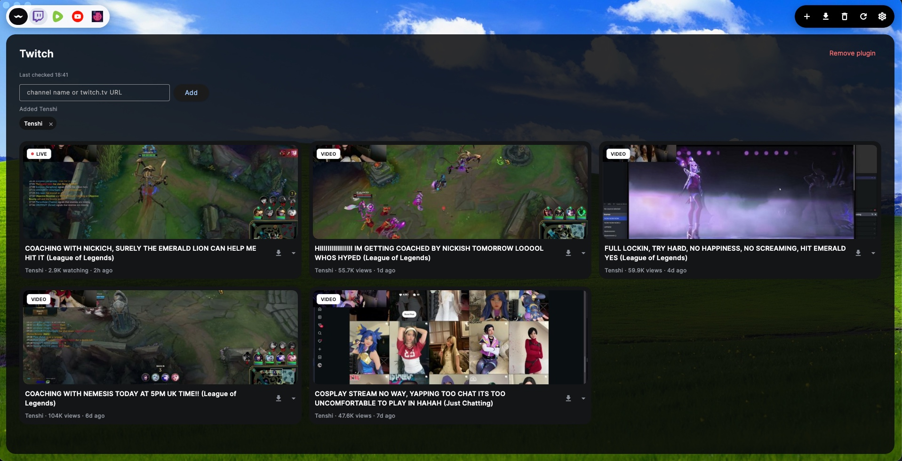
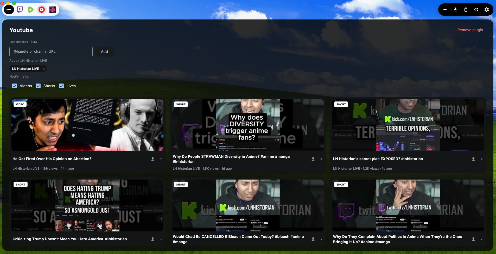
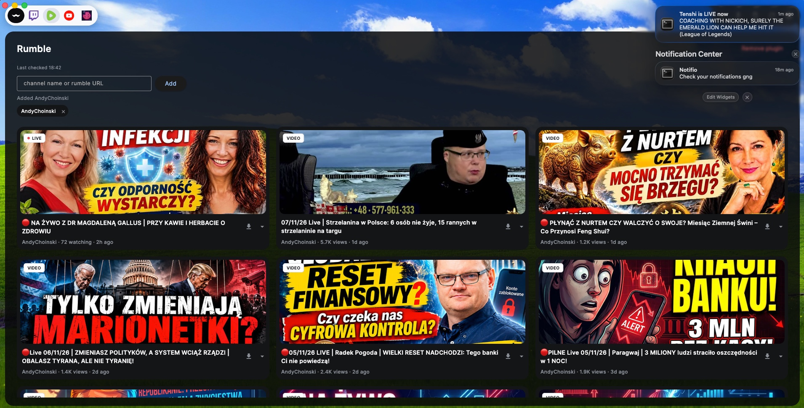
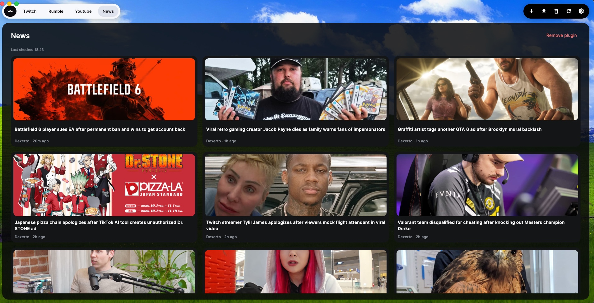

<p align="center">
  
</p>

<h1 align="center">Notifio</h1>

<p align="center">
  A lightweight menu bar app that watches your favorite creators and news sources and pings you the moment something new happens.
</p>

---

Built with Python and [Flet](https://flet.dev). Notifio tracks **Twitch, YouTube, Rumble and news feeds** (powered by [Dexerto](https://www.dexerto.com)) with no accounts and no API keys.


---

## Download

Grab the latest build from the [Releases page](https://github.com/he3vn/Notifio/releases) — no Python install required:

| Platform | Download | Status |
|----------|----------|--------|
| macOS | [Notifio-macOS.zip](https://github.com/he3vn/Notifio/releases/download/reborn/Notifio-macOS.zip) | Fully tested |
| Windows | [Notifio-Windows.zip](https://github.com/he3vn/Notifio/releases/latest/download/Notifio-Windows.zip) | **Experimental** |


> You may need to right-click → Open the first time to bypass Gatekeeper on macOS. On Windows, SmartScreen may ask you to confirm the first launch.

---

## What it offers

- **Live and upload alerts** — get notified when a Twitch, YouTube or Rumble channel goes live, uploads a video, posts a Short or schedules a stream
- **News feed** — fetches the latest articles from Dexerto's RSS feed
- **Native notifications** — grouped into one banner when many arrive at once; clicking one opens the item
- **Menu bar / system tray app** — "Open Notifio" shortcut, a missed-notifications counter, "Recheck now" and "Quit"
- **Hides instead of quitting** — closing the window sends Notifio to the tray so checks keep running
- **Single instance** — launching Notifio again just brings the running one to the front
- **Setup wizard** — set your name, picture and plugins on first run
- **Notification history** — browse everything you've been pinged about
- **Reminders** — choose an interval (5 min to 2 hours) and Notifio will ping you to check new notifications if anything arrived since you last looked
- **Downloads** — save YouTube videos, Shorts, completed lives, Twitch streams/VODs and Rumble videos
- **Resume downloads** — if the app closes mid-download, the job is queued again on the next launch and continues from the partial file when possible
- **QuickTime-friendly files** — downloads are remuxed/re-encoded with FFmpeg into H.264/AAC MP4 so they open in QuickTime and Windows players
- **Wipe history** — remove every followed channel and all notifications, then return to the setup screen
- **Refresh on demand** — checks run every 30 seconds, or hit the refresh button to check immediately
- **No accounts or API keys** — for any source

---

## Screenshots
<!-- Real screenshots live in Assets/dd/. -->

### 1. Setup



### 2. Twitch



### 3. YouTube



### 4. Rumble



### 5. News + Settings



---

## Plugins

| Plugin | What it tracks | How it works |
|--------|----------------|--------------|
| **Twitch** | Live streams and VODs | Twitch's public web GraphQL endpoint. Pings when a followed channel goes live. |
| **YouTube** | Videos, Shorts, live streams, scheduled streams | Channel RSS feeds, plus a check of each new video to classify it. Pick which kinds you want alerts for. |
| **Rumble** | Videos, Shorts, live streams | Reads the video data embedded in the channel page. Needs `curl_cffi` (see below). |
| **News** | Articles | Dexerto RSS feed. |

### What you can paste when adding a channel

| Plugin | Accepted |
|--------|----------|
| **Twitch** | `https://www.twitch.tv/name`, `name`, or `@name` |
| **YouTube** | `@handle`, `https://www.youtube.com/@handle`, `https://www.youtube.com/channel/UC...`, or a raw `UC...` channel ID |
| **Rumble** | `https://rumble.com/c/Name` or `https://rumble.com/user/Name`. A bare name is assumed to be `/c/`, so use the full URL for `/user/` channels. |

Copy the URL from the channel's own page rather than retyping the name. Some handles contain lookalike letters (a lowercase `l` and a capital `I`, for example).

### How alerts behave

- The first check of a plugin only records what already exists. Nothing pings until something new appears after you add it.
- If more than 3 new items arrive at once, you get a single "N new notifications" banner instead of one per item.
- YouTube live streams that were scheduled get rechecked and ping once they actually start. After a live stream ends it is rechecked again and becomes downloadable as a normal video.
- History keeps the latest 500 items, and the app shows the latest 50 per plugin.

---

## Downloads

Downloads are powered by [yt-dlp](https://github.com/yt-dlp/yt-dlp). You can download directly from a notification card, or use the arrow next to the download button to pick a quality.

- **Quality** — Best, 1080p, 720p, 480p, 360p, 240p, 144p or audio-only MP3
- **Where files go** — `~/Downloads/Notifio` (`%USERPROFILE%\Downloads\Notifio` on Windows)
- **Formats** — Notifio prefers H.264 video + AAC audio in an MP4 container, which QuickTime and Windows Media Player can open
- **Old/odd streams** — if the best source is VP9/Opus/AV1 or a raw `.ts` stream, Notifio remuxes it or re-encodes it with FFmpeg into a compatible MP4
- **Resume** — active jobs are saved in `downloads.json`; reopen the app and they continue from the `.part` file if the server supports it, or start again otherwise

Install FFmpeg for the best results:

```bash
# macOS (Homebrew)
brew install ffmpeg

# Windows (Chocolatey, in an Administrator PowerShell)
choco install ffmpeg -y
```

Notifio also checks for a bundled `Assets/ffmpeg` / `Assets/ffmpeg.exe` first, then your `PATH`.

---

## Reminders

Open **Settings → Reminders** and turn on "Remind me to check notifications". Pick an interval from 5 minutes to 2 hours (or leave it off). Notifio only reminds you when at least one notification arrived **after** the last time you looked at the app, so it will not nag you about old history.

- macOS: delivered with `terminal-notifier` when available, otherwise the native notification center/tray banner
- Windows: delivered with `winotify`/the tray balloon
- Use **Send test reminder** to check that notifications are allowed

> Optional on macOS: `brew install terminal-notifier` gives the most reliable banner delivery. Without it, Notifio uses its built-in notification/tray fallback.

---

## Running from source

### macOS

You'll need Python 3.10+ installed.

```bash
git clone https://github.com/he3vn/Notifio.git
cd Notifio
python3 -m pip install -r requirements.txt
python3 main.py
```

### Windows (experimental)

You'll need Python 3.10+ and the [Microsoft Visual C++ Build Tools](https://visualstudio.microsoft.com/visual-cpp-build-tools/) for some optional packages.

```powershell
git clone https://github.com/he3vn/Notifio.git
cd Notifio
py -m pip install -r requirements.txt
py main.py
```

On first launch you'll go through a short setup where you pick your name, picture and plugins. After that it drops you into the notification center.

### Requirements

```text
flet[all]==1.1.0
flet-video==1.1.0
pyinstaller>=6.0.0
Pillow>=10.0.0
certifi
curl_cffi
yt-dlp[default]
pyobjc-core; sys_platform == "darwin"
pyobjc-framework-Cocoa; sys_platform == "darwin"
pyobjc-framework-UserNotifications; sys_platform == "darwin"
winotify>=1.1.0; sys_platform == "win32"
pystray>=0.19.5; sys_platform == "win32"
```

`curl_cffi` is what lets Notifio read Rumble. Rumble sits behind Cloudflare, which blocks plain Python and curl requests, so Notifio makes the request with a Chrome-like TLS fingerprint instead.

`ffmpeg` is optional but strongly recommended: it merges high-quality video/audio streams and produces the compatible MP4 files described above. `deno` is also recommended for YouTube support.

---

## Building a standalone app

```bash
python3 build.py            # build for the current platform
python3 build.py --macos    # build Notifio-macOS.zip (run on macOS)
python3 build.py --windows  # build Notifio-Windows.zip (run on Windows)
```

The build creates a `dist/` folder with:

- **macOS** — `Notifio.app` + `Notifio-macOS.zip`
- **Windows** — `Notifio.exe` / `Notifio` folder + `Notifio-Windows.zip` (experimental)

PyInstaller cannot cross-compile, so a Windows `.exe` must be built on Windows. The GitHub release workflow does this automatically on a Windows runner when a `v*` tag is pushed.

---

## How it's organized

```text
Notifio/
├── main.py              Entry point: single-instance check, tray mode, starts the UI
├── build.py             macOS + Windows packaging
├── Assets/              Fonts, icons, plugin logos, images, optional ffmpeg
├── UI/
│   ├── ui.py            App window, setup flow, poller wiring, tray lifecycle
│   └── components/      Loading screen, setup wizard, plugin picker, home screen, cards
└── Backend/
    ├── poller.py        Background loop that checks every enabled plugin
    ├── notifications.py History and "already seen" tracking
    ├── notifier.py      Native notification banners (terminal-notifier / winotify)
    ├── reminders.py     Periodic "check your notifications" reminders
    ├── downloader.py    yt-dlp downloads, resume queue and FFmpeg compatibility pass
    ├── app_reset.py     Wipe history and channel data
    ├── control.py       Local socket used for single instance and tray commands
    ├── tray.py          Menu bar icon (separate process)
    ├── storage.py       Atomic JSON read/write
    ├── youtube/         YouTube plugin
    ├── twitch/          Twitch plugin
    ├── rumble/          Rumble plugin
    └── dexerto/         News plugin and shared feed helpers
```

Each plugin exposes a fetch function that returns a list of items (`title`, `link`, `ts`, `source`, and optionally `kind` and `channel_id`). The poller registers them in one table, so adding a source means writing a fetcher and adding a line there.

---

## Where your data lives

Notifio stores everything in `~/.notifio` (or the folder in `FLET_APP_STORAGE_DATA` when set):

| File | Contents |
|------|----------|
| `user_setup.json`, `user.json` | Your name and chosen plugins |
| `settings.json` | Quality, sound, reminder and appearance settings |
| `notifications.json` | Notification history |
| `seen.json` | Items already seen, so nothing pings twice |
| `downloads.json` | Active downloads that are resumed after a restart |
| `youtube_channels.json`, `youtube_prefs.json` | Followed YouTube channels and alert kinds |
| `twitch_channels.json` | Followed Twitch channels |
| `rumble_channels.json` | Followed Rumble channels |
| `missed.json` | Count shown in the menu bar/tray |
| `ui.log`, `tray.log` | Logs for troubleshooting |

**Settings → Setup → Wipe history** deletes all of the above (except logs and downloaded files) and returns you to the setup screen. You can also delete the folder to start from scratch.

---

## Known limits

- **Twitch** uses the same public GraphQL endpoint the Twitch website uses. It's unofficial and could change without notice.
- **Rumble** has no public API, so Notifio reads the channel page. If Rumble changes its pages, Rumble checks will start failing until the reader is updated.
- **Rumble's "LIVE" label** stays on an item after the stream ends, since stored items aren't rechecked.
- **Windows support is experimental.** The code paths exist, but the Windows build has not been tested on real hardware yet.
- **Very old/rare codecs** may need a manual FFmpeg conversion if a source only provides a format that cannot be remuxed.

---

## Troubleshooting

### Why can't I open downloaded VODs?

Our VOD downloader downloads the entire live stream and then concatenates the segments before you can download them. Simply "merging" `.ts` or `.mp4` file chunks often breaks the file header. Video players expect a specific structure, not just a raw pile of data.

Notifio now runs every finished video through FFmpeg to remux/re-encode it into a normal MP4. If you still have an old broken file, or FFmpeg is missing, fix it manually:

```bash
ffmpeg -i "/Users/me/Downloads/asmongold-monks-love-trump.ts" -c copy -bsf:a aac_adtstoasc "/Users/me/Downloads/asmongold-monks-love-trump-fix1.mp4"
```

The `/Users/me/Downloads/asmongold-monks-love-trump.ts` is the broken downloaded file, and the `/Users/me/Downloads/asmongold-monks-love-trump-fix1.mp4` is the fixed file.

If the video codec is also unsupported (for example VP9/AV1), re-encode it instead:

```bash
ffmpeg -i "/Users/me/Downloads/asmongold-monks-love-trump.ts" -c:v libx264 -preset veryfast -crf 20 -c:a aac -b:a 192k "/Users/me/Downloads/asmongold-monks-love-trump-fix1.mp4"
```

### Install FFmpeg on macOS (Homebrew)

Watch this video: <https://www.youtube.com/watch?v=9z8ooWfaIrM>, or follow the steps below:

1. Install Homebrew (if you don't have it). Open Terminal and run:

   ```bash
   /bin/bash -c "$(curl -fsSL https://raw.githubusercontent.com/Homebrew/install/HEAD/install.sh)"
   ```

   Verify:

   ```bash
   brew --version
   ```

2. Install FFmpeg:

   ```bash
   brew install ffmpeg
   ```

3. Verify installation:

   ```bash
   ffmpeg -version
   ```

### Installing FFmpeg on Windows (with Chocolatey)

[Chocolatey](https://chocolatey.org/) is a package manager for Windows. It lets you install, update and manage software with simple command-line commands instead of downloading installers manually.

1. Open PowerShell as Administrator: right-click Start → Windows Terminal (Admin) or PowerShell (Admin)
2. Install FFmpeg:

   ```powershell
   choco install ffmpeg -y
   ```

3. Verify installation — close and reopen PowerShell, then run:

   ```powershell
   ffmpeg -version
   ```

### Other common issues

- **A Rumble channel won't add** (`HTTP 403`, or "page doesn't look like a Rumble channel"): make sure `curl_cffi` is installed for the same Python you launch Notifio with (`python3 -m pip install curl_cffi`), then restart the app.
- **"no channel with that name"**: copy the full channel URL from your browser instead of typing the name.
- **No notifications appear**: check System Settings → Notifications (macOS) or Settings → System → Notifications (Windows) and allow Notifio.
- **Menu bar/tray icon is missing**: look at `~/.notifio/tray.log` (`%USERPROFILE%\.notifio\tray.log` on Windows).
- **Downloads fail with "yt-dlp not installed"**: run `python3 -m pip install -U "yt-dlp[default]"`.
- **QuickTime says the file is not compatible**: install FFmpeg, then retry the download. Notifio will produce a fresh H.264/AAC MP4.
- **App won't reopen after a crash**: run `python3 main.py` (or `py main.py`) once from a terminal and read the error.

---

## License

MIT

---

## Disclosed AI usage

- Readme.md
- Patches for downloads
- Tray, build.py and github stuff/license
- Moving effect for landing screen
- rumbefeed scraping
- _toast.py

and thats it some of these were partially made by me but after research and debugging i couldnt continue with the risk of fraud

**Assets:**

Made by me,

- Unsplash
- Moelivewallpapers

Thank you for all!
