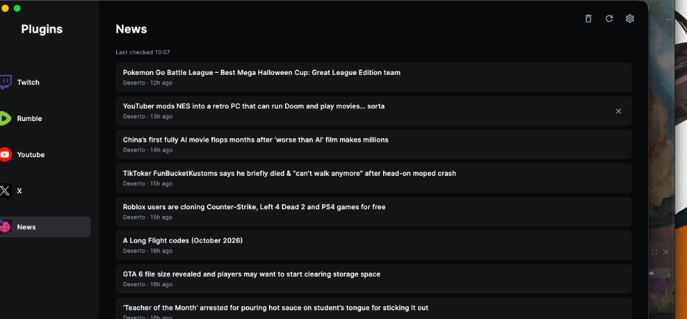

<p align="center">
  
</p>

<h1 align="center">Notifio</h1>

<p align="center">
  A lightweight desktop notification center that pulls news and updates into one clean window.
</p>

---

Built with Python and [Flet](https://flet.dev). Currently supports **news feeds via RSS** (powered by [Dexerto](https://www.dexerto.com)), with more plugin sources planned.



---

## Download

Grab the latest build from the [Releases page](https://github.com/he3vn/Notifio/releases) — no Python install required:

| Platform | Download |
|----------|----------|
| macOS | [Notifio-macOS.zip](https://github.com/he3vn/Notifio/releases/latest/download/Notifio-macOS.zip) |
| Windows | [Notifio-Windows.zip](https://github.com/he3vn/Notifio/releases/latest/download/Notifio-Windows.zip) |
| Linux | [Notifio-Linux.tar.gz](https://github.com/he3vn/Notifio/releases/latest/download/Notifio-Linux.tar.gz) |

> On macOS you may need to right-click → Open the first time to bypass Gatekeeper.

---

## What it does

- **Setup wizard** — pick your name and choose which plugins to enable  
- **News plugin** — fetches the latest articles from Dexerto's RSS feed automatically every 5 minutes  
- **Desktop notifications** — get a native notification with sound when new articles drop  
- **Notification center** — browse, click to read, and dismiss articles from the sidebar  
- **Clear & refresh** — manually refresh the feed or clear all notifications with one click  

---

## Running from source

You'll need Python 3.10+ installed.

```bash
git clone https://github.com/he3vn/Notifio.git
cd Notifio
pip install -r requirements.txt
python3 main.py
```

On first launch you'll go through a short setup where you pick your name and choose which plugins to enable. After that it drops you into the notification center.

---

## Building a standalone app

```bash
python3 build.py
```

This creates a `dist/` folder with:
- **macOS** — `Notifio.app` + `Notifio-macOS.zip`
- **Windows** — `Notifio.exe` + `Notifio-Windows.zip`
- **Linux** — `Notifio` binary + `Notifio-Linux.tar.gz`

---

## Roadmap

Plugins on the sidebar that aren't wired up yet (Twitch, Rumble, YouTube, X, Patreon, Slack, Facebook) are planned for future updates. The plugin architecture is already in place — each source just needs a feed fetcher.

---

## License

MIT
