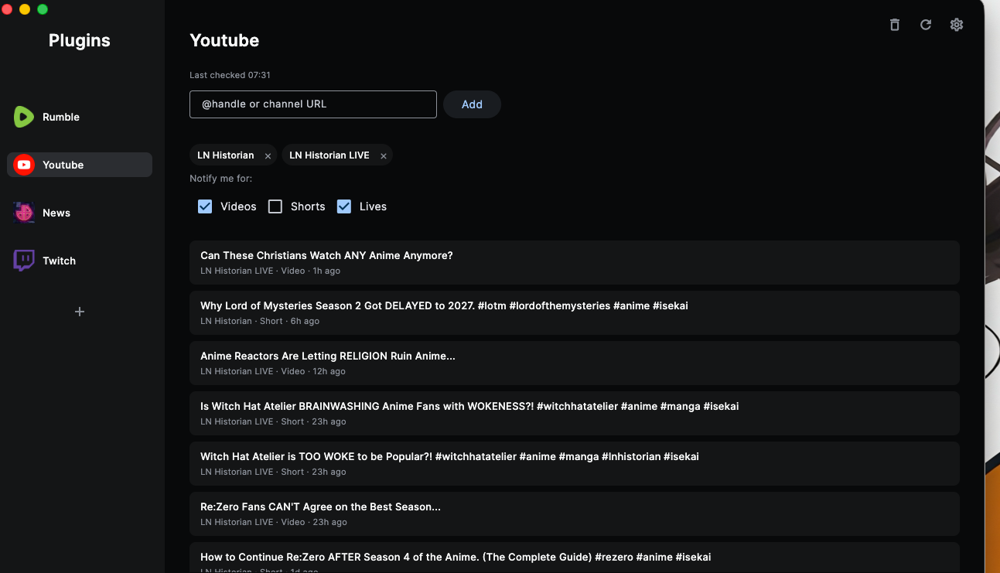
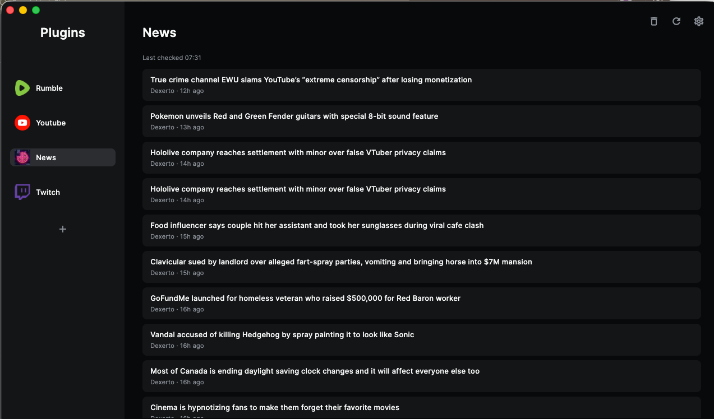
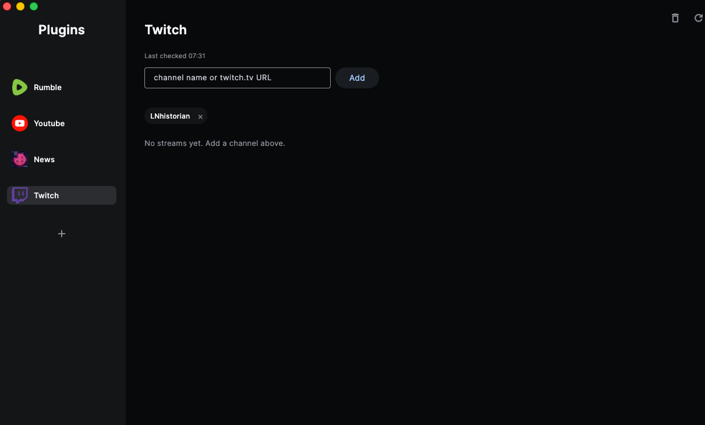
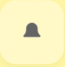

<p align="center">
  
</p>

<h1 align="center">Notifio</h1>

<p align="center">
  A lightweight menu bar app that watches your favorite creators and news sources and pings you the moment something new happens.
</p>

---

Built with Python and [Flet](https://flet.dev). Notifio tracks **Twitch, YouTube, Rumble and news feeds** (powered by [Dexerto](https://www.dexerto.com)) with no accounts and no API keys.


---

## Download

Grab the latest build from the [Releases page](https://github.com/he3vn/Notifio/releases) — no Python install required:

| Platform | Download |
|----------|----------|
| macOS | [Notifio-macOS.zip](https://github.com/he3vn/Notifio/releases/latest/download/Notifio-macOS.zip) |

> You may need to right-click → Open the first time to bypass Gatekeeper.

> **Note:** Notifio is built for macOS. The UI runs on any platform, but the menu bar, desktop notifications and packaging rely on macOS-specific APIs.

---

## What it does

- **Live and upload alerts** — get notified when a Twitch, YouTube or Rumble channel goes live or posts something new
- **News feed** — fetches the latest articles from Dexerto's RSS feed
- **Native macOS notifications** — grouped into one banner when many arrive at once
- **Menu bar app** — "Open Notifio" shortcut, a missed-notifications counter, "Recheck now" and "Quit"
- **Hides instead of quitting** — closing the window sends Notifio to the menu bar so checks keep running
- **Single instance** — launching Notifio again just brings the running one to the front
- **Setup wizard** — set your name, picture and plugins on first run
- **Notification history** — browse everything you've been pinged about
- **Refresh on demand** — checks run every 30 seconds, or hit the refresh button to check immediately
- **No accounts or API keys** — for any source

---

## Screenshots

### YouTube Alerts & Preferences
> Filter notifications by Videos, Shorts, or Lives, and manage followed channels.



### News Feed (Dexerto)
> Real-time gaming, tech, and entertainment news feed with direct links.



### Twitch Live Alerts
> Follow Twitch streamers and receive alerts the moment they go live.



### macOS Menu Bar Indicator
> Lightweight menu bar tray app showing missed notification counts and quick actions.



---

## Plugins

| Plugin | What it tracks | How it works |
|--------|----------------|--------------|
| **Twitch** | Live streams | Twitch's public web GraphQL endpoint. Pings when a followed channel goes live. |
| **YouTube** | Videos, Shorts, live streams, scheduled streams | Channel RSS feeds, plus a check of each new video to classify it. Pick which kinds you want alerts for. |
| **Rumble** | Videos, Shorts, live streams | Reads the video data embedded in the channel page. Needs `curl_cffi` (see below). |
| **News** | Articles | Dexerto RSS feed. |

### What you can paste when adding a channel

| Plugin | Accepted |
|--------|----------|
| **Twitch** | `https://www.twitch.tv/name`, `name`, or `@name` |
| **YouTube** | `@handle`, `https://www.youtube.com/@handle`, `https://www.youtube.com/channel/UC...`, or a raw `UC...` channel ID |
| **Rumble** | `https://rumble.com/c/Name` or `https://rumble.com/user/Name`. A bare name is assumed to be `/c/`, so use the full URL for `/user/` channels. |

Copy the URL from the channel's own page rather than retyping the name. Some handles contain lookalike letters (a lowercase `l` and a capital `I`, for example).

### How alerts behave

- The first check of a plugin only records what already exists. Nothing pings until something new appears after you add it.
- If more than 3 new items arrive at once, you get a single "N new notifications" banner instead of one per item.
- YouTube live streams that were scheduled get rechecked and ping once they actually start.
- History keeps the latest 500 items, and the app shows the latest 50 per plugin.

---

## Running from source

You'll need macOS and Python 3.10+ installed.

```bash
git clone https://github.com/he3vn/Notifio.git
cd Notifio
python3 -m pip install -r requirements.txt
python3 main.py
```

On first launch you'll go through a short setup where you pick your name, picture and plugins. After that it drops you into the notification center.

### Requirements

```text
flet>=1.0.4
pyinstaller>=6.0.0
Pillow>=10.0.0
certifi
rumps
curl_cffi
```

`curl_cffi` is what lets Notifio read Rumble. Rumble sits behind Cloudflare, which blocks plain Python and curl requests, so Notifio makes the request with a Chrome-like TLS fingerprint instead.

---

## Building a standalone app

```bash
python3 build.py
```

This packs the app with `flet pack` and creates a `dist/` folder with:
- **macOS** — `Notifio.app` + `Notifio-macOS.zip`

The build only runs on macOS.

---

## How it's organized

```text
Notifio/
├── main.py              Entry point: single-instance check, tray mode, starts the UI
├── build.py             macOS packaging
├── Assets/              Fonts, icons, plugin logos, images
├── UI/
│   ├── ui.py            App window, setup flow, poller wiring, tray lifecycle
│   └── components/      Loading screen, setup wizard, plugin picker, home screen
└── Backend/
    ├── poller.py        Background loop that checks every enabled plugin
    ├── notifications.py History and "already seen" tracking
    ├── notifier.py      macOS notification banners
    ├── control.py       Local socket used for single instance and tray commands
    ├── tray.py          Menu bar icon (separate process)
    ├── storage.py       Atomic JSON read/write
    ├── youtube/         YouTube plugin
    ├── twitch/          Twitch plugin
    ├── rumble/          Rumble plugin
    └── dexerto/         News plugin and shared feed helpers
```

Each plugin exposes a fetch function that returns a list of items (`title`, `link`, `ts`, `source`, and optionally `kind` and `channel_id`). The poller registers them in one table, so adding a source means writing a fetcher and adding a line there.

---

## Where your data lives

Notifio stores everything in `~/.notifio` (or the folder in `FLET_APP_STORAGE_DATA` when set):

| File | Contents |
|------|----------|
| `user_setup.json`, `user.json` | Your name and chosen plugins |
| `notifications.json` | Notification history |
| `seen.json` | Items already seen, so nothing pings twice |
| `youtube_channels.json`, `youtube_prefs.json` | Followed YouTube channels and alert kinds |
| `twitch_channels.json` | Followed Twitch channels |
| `rumble_channels.json` | Followed Rumble channels |
| `missed.json` | Count shown in the menu bar |
| `ui.log`, `tray.log` | Logs for troubleshooting |

Delete this folder to start from scratch.

---

## Known limits

- **Twitch** uses the same public GraphQL endpoint the Twitch website uses. It's unofficial and could change without notice.
- **Rumble** has no public API, so Notifio reads the channel page. If Rumble changes its pages, Rumble checks will start failing until the reader is updated.
- **Rumble's "LIVE" label** stays on an item after the stream ends, since stored items aren't rechecked.
- **macOS only.** The tray, notifications and packaging all use macOS APIs.

---

## Troubleshooting

- **A Rumble channel won't add** (`HTTP 403`, or "page doesn't look like a Rumble channel"): make sure `curl_cffi` is installed for the same Python you launch Notifio with (`python3 -m pip install curl_cffi`), then restart the app.
- **"no channel with that name"**: copy the full channel URL from your browser instead of typing the name.
- **No notifications appear**: check System Settings → Notifications and allow banners for Notifio.
- **Menu bar icon is missing**: look at `~/.notifio/tray.log`.
- **App won't reopen after a crash**: run `python3 main.py` once from Terminal and read the error.

---

## License

MIT